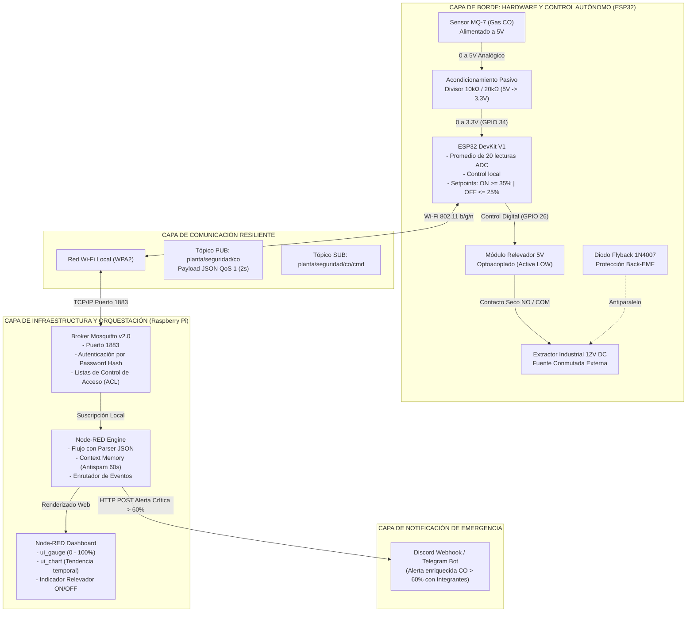

# Sistema Embebido IoT para Automatización de Procesos Reales: Control en Lazo Cerrado de Monóxido de Carbono (CO) y Extracción de Emergencia

[](https://github.com/KeVINj29/proyecto-integrador-iot-mq7)
[](#)
[](#)
[](#)
[](#)

---

## Información Institucional y del Curso

* **Materia:** Internet de las Cosas
* **Semestre:** 7mo Semestre
* **Docente Titular:** Andrés Salomón Enríquez Ochoa
* **Proyecto:** Desarrollo y Despliegue de un Sistema Embebido IoT para Automatización de Procesos Reales (MVP Industrial)
* **Repositorio Oficial:** [https://github.com/KeVINj29/proyecto-integrador-iot-mq7](https://github.com/KeVINj29/proyecto-integrador-iot-mq7)

---

## Tabla Oficial de Integrantes y Asignación de Roles

| Rol Oficial Obligatorio | Responsable (Nombre Completo) | Matrícula | Módulo Técnico Asignado |
| :--- | :--- | :--- | :--- |
| **Rol 1: Ingeniero/a de Hardware y Sensores** | *Juan Daniel Muñoz Azpeitia* | *230110520* | Acondicionamiento de señales analógicas (Divisor resistivo), conexionado eléctrico, aislamiento galvánico de potencia y muestreo ADC en ESP32. |
| **Rol 2: Ingeniero/a de Comunicaciones e Infraestructura** | *Sebastian López Aguas* | *230110557* | Esquema y serialización de telemetría JSON, seguridad del Broker Mosquitto (ACL y autenticación), gestión resiliente no bloqueante de red. |
| **Rol 3: Ingeniero/a de Software y Orquestación** | *Jorge Salvador Vazquez Garcia* | *230110516* | Flujos de control en Node-RED, interfaz visual interactiva en Node-RED Dashboard y sistema de alertas críticas a Discord/Telegram con memoria antispam. |
| **Rol 4: Ingeniero/a de Integración y Calidad (QA / Testing & Field Test)** | *Kevin de Jesús Ramírez López* | *230110634* | Pruebas de estrés y forzamiento físico, validación de lazo cerrado sin nube (resiliencia offline), análisis de fallos, logs seriales, compilación técnica del reporte y producción de evidencias multimedia (grabación y edición del video demostrativo). |

---

## Video de Demostración del Prototipo en Vivo (< 3 minutos)

> [!IMPORTANT]
> El video debe mostrar la participación activa de los integrantes del equipo con el circuito físico real en funcionamiento y una prueba de estrés mediante la variación controlada de la lectura del sensor MQ-7. En la versión actual se evidencia la activación del relevador y la salida serial; el dashboard y las notificaciones requieren la versión futura con conectividad MQTT.

🔗 **Enlace al Video de Demostración:** `[AQUÍ VA EL ENLACE DEL VIDEO (YouTube / Google Drive / OneDrive)]`

---

## Descripción del Proyecto y Arquitectura de Control

El proyecto consiste en una estación de control ambiental y mitigación de atmósferas peligrosas basada en **Edge Computing** y **Control en Lazo Cerrado**. El firmware actualmente validado (`firmware_esp32/codigo_esp32.ino`) lee el sensor MQ-7 mediante el ADC del ESP32 y controla localmente un extractor de 12V con un relevador. La integración Wi-Fi/MQTT y el dashboard de Node-RED están definidos como una capa independiente para una versión posterior del firmware.

### Lógica de Control Autónomo (Independiente de la Nube)
* **Banda Muerta (Histéresis):**
  * **Activación ($CO \ge 35.0\%$):** Conmuta el relevador a estado ACTIVO (nivel bajo en GPIO 26) para disipar el gas acumulado.
  * **Desactivación ($CO \le 25.0\%$):** Retorna el relevador a reposo cuando el aire circundante vuelve a niveles seguros, protegiendo los platinos mecánicos de conmutaciones parásitas continuas (*chattering*).
* **Escala de lectura actual:** El firmware convierte linealmente el ADC de 0–4095 a 0–100 %. Esta escala es de diagnóstico y no equivale todavía a ppm calibradas de CO.
* **Continuidad operativa:** El sensado y la conmutación se ejecutan localmente en el ESP32. El firmware actual no inicia Wi-Fi ni MQTT, por lo que no depende de Raspberry Pi, broker o red.
* **Integración prevista:** Node-RED consume el contrato JSON del tópico `planta/seguridad/co`, muestra el dashboard y aplica alertas antispam; esa ruta requiere un firmware de comunicación que publique dicho contrato.

---

## Diagrama de Arquitectura Global del Sistema (Mermaid)



---

## Formato del Payload de Telemetría (JSON)

El flujo de Node-RED espera que una futura versión con conectividad publique cada 2 segundos hacia el tópico `planta/seguridad/co` el siguiente formato serializado. `codigo_esp32.ino` no publica MQTT; actualmente entrega diagnóstico por el monitor serial:

```json
{
  "nodo": "ESP32_Planta_CO_01",
  "sensor": "MQ-7 (CO Industrial)",
  "adc_raw": 1460,
  "co_pct": 35.65,
  "setpoint_on": 35.0,
  "setpoint_off": 25.0,
  "actuador": "ENCENDIDO",
  "alerta_critica": false,
  "uptime_ms": 12000,
  "wifi_rssi": -59
}
```

---

## Guía de Despliegue Paso a Paso en la Raspberry Pi

### 1. Configuración de Mosquitto con Seguridad y ACL
En la terminal de la Raspberry Pi (Raspberry Pi OS):

```bash
# 1. Instalar broker y utilidades cliente
sudo apt update && sudo apt install -y mosquitto mosquitto-clients

# 2. Crear archivo de credenciales para el operador de planta
sudo mosquitto_passwd -c /etc/mosquitto/passwd iot_operator
# (Ingresar contraseña segura, ej: M0squitt0_Pass#2026)

# 3. Crear el archivo de Listas de Control de Acceso (ACL)
sudo nano /etc/mosquitto/aclfile
```

Añadir el contenido de permisos por tópico:
```text
user iot_operator
topic readwrite planta/seguridad/#
```

Configurar el demonio principal en `/etc/mosquitto/mosquitto.conf`:
```text
listener 1883
allow_anonymous false
password_file /etc/mosquitto/passwd
acl_file /etc/mosquitto/aclfile
```

Reiniciar y habilitar el servicio:
```bash
sudo systemctl restart mosquitto
sudo systemctl enable mosquitto
```

### 2. Despliegue de Node-RED y Nodos de Dashboard
```bash
# 1. Instalar módulos de interfaz gráfica
cd ~/.node-red
npm install node-red-dashboard

# 2. Iniciar el servicio Node-RED
node-red-start
# (O habilitar como servicio: sudo systemctl enable --now nodered.service)
```

1. Abrir en el navegador: `http://<IP_RASPBERRY_PI>:1880`
2. Ir a **Menú Hamburguesa** $\rightarrow$ **Import** $\rightarrow$ **Select a file to import**.
3. Seleccionar el archivo [nodered/flows.json](nodered/flows.json).
4. Hacer doble clic en el nodo `Mosquitto Local Raspberry Pi` y configurar el usuario `iot_operator` y su contraseña.
5. Colocar la URL de tu Webhook en el nodo `Disparo Webhook Discord / Telegram` (no usar la URL de ejemplo).
6. Presionar el botón rojo **Deploy**.
7. Acceder al tablero interactivo en: `http://<IP_RASPBERRY_PI>:1880/ui`.

---

## Sección de Evaluación Individual de Roles

> [!IMPORTANT]
> A continuación se expone la justificación de ingeniería obligatoria de cada uno de los 4 roles que integran el equipo:

### Rol 1: Ingeniero/a de Hardware y Sensores (Firmware / Hardware)
* **1. ¿Cuáles fueron los principales desafíos técnicos que enfrentaste en tu módulo?**  
  * *Acondicionamiento y Rango Dinámico:* El sensor MQ-7 opera a 5V con impedancia de salida variable, mientras que el convertidor ADC del ESP32 está diseñado para un límite destructivo de 3.3V y presenta una marcada no linealidad en sus extremos de lectura. Se calculó rigurosamente un divisor de tensión resistivo pasivo con tolerancias del 1% ($10\,\text{k}\Omega / 20\,\text{k}\Omega$) garantizando una impedancia equivalente Thévenin de $6.67\,\text{k}\Omega$ para cargar adecuadamente el capacitor interno de muestreo del ESP32.
  * *Filtrado y Aislamiento Inductivo:* La conmutación de un extractor inductivo de 12V produce picos transitorios por fuerza contraelectromotriz (Back-EMF). Se resolvió desacoplando galvánicamente la bobina mediante un optoacoplador en el módulo relevador e incorporando un diodo rectificador de marcha libre (*flyback*) **1N4007** en antiparalelo a las terminales del motor. El firmware actual reduce variaciones mediante un promedio de 20 muestras por ciclo.
* **2. ¿Cómo reacciona tu módulo si el microcontrolador pierde alimentación eléctrica o si la Raspberry Pi se desconecta de la red durante la operación del proceso?**  
  * *Pérdida de alimentación del ESP32:* Por diseño físico (*Fail-Safe*), el relevador posee contactos normalmente abiertos (NO). Al quedarse sin energía la bobina, los contactos mecánicos se abren por la fuerza del resorte, apagando el motor de 12V y evitando cualquier condición de sobrecalentamiento no supervisada de la etapa de potencia.
  * *Desconexión de la Raspberry Pi de la red:* El firmware actual no utiliza la Raspberry Pi ni la red. Continúa muestreando el sensor y conmutando el relevador localmente; cada ciclo toma 20 muestras separadas por 10 ms y actualiza el monitor serial aproximadamente cada segundo.

---

### Rol 2: Ingeniero/a de Comunicaciones e Infraestructura (Broker / Network)
* **1. ¿Cuáles fueron los principales desafíos técnicos que enfrentaste en tu módulo?**  
  * *Alcance actual:* La versión validada del firmware no contiene cliente Wi-Fi/MQTT ni lógica de reconexión. La comunicación segura, ACL y reconexión no bloqueante pertenecen a la integración prevista del Rol 2 y deben validarse con una versión conectada.
  * *Seguridad y Optimización del Payload:* Configurar Mosquitto en la Raspberry Pi bajo la directiva `allow_anonymous false` implementando autenticación basada en hash de contraseñas y listas de control de acceso (ACL) para acotar permisos estrictos de lectura/escritura únicamente sobre el árbol de tópicos `planta/seguridad/#`. El payload JSON fue optimizado para no exceder 384 bytes, reduciendo el consumo de ancho de banda y la fragmentación de memoria RAM.
* **2. ¿Cómo reacciona tu módulo si el microcontrolador pierde alimentación eléctrica o si la Raspberry Pi se desconecta de la red durante la operación del proceso?**  
  * *Pérdida de alimentación del ESP32:* No se genera telemetría mientras el dispositivo está apagado. Al restablecer la alimentación, `setup()` deja el relevador en estado APAGADO antes de iniciar el muestreo.
  * *Desconexión de la Raspberry Pi:* No modifica el control local porque el firmware actual no tiene dependencia de red; la reconexión MQTT no forma parte de esta versión.

---

### Rol 3: Ingeniero/a de Software y Orquestación (Node-RED / Dashboard / Bot)
* **1. ¿Cuáles fueron los principales desafíos técnicos que enfrentaste en tu módulo?**  
  * *Control de Inundación de Alertas (integración prevista):* El flujo Node-RED evita repetir alertas durante 60 segundos y rearma el estado cuando el valor cae a 25 % o menos. Esta ruta sólo se activa cuando recibe el payload JSON esperado; el firmware actual no genera ese payload.
  * *Diseño Ergonómico de la UI Industrial:* Normalización y deserialización de flujos de datos asíncronos en Node-RED Dashboard, organizando indicadores de aguja (*ui_gauge*), gráficos cronológicos de tendencia continua (*ui_chart*) y componentes visuales reactivos mediante código HTML/CSS dinámico para señalizar de inmediato el encendido del extractor.
* **2. ¿Cómo reacciona tu módulo si el microcontrolador pierde alimentación eléctrica o si la Raspberry Pi se desconecta de la red durante la operación del proceso?**  
  * *Pérdida de alimentación del ESP32:* El dashboard de Node-RED conserva en pantalla el último estado recibido e indica visualmente el cese del flujo de paquetes tras expirar el intervalo de actualización. No se emiten falsas alarmas de emergencia puesto que la lógica evalúa el valor numérico recibido y valida la estampa de tiempo.
  * *Desconexión de la Raspberry Pi:* El dashboard y las alertas dejan de procesar telemetría, pero el lazo local del ESP32 continúa funcionando porque no depende de Node-RED.

---

### Rol 4: Ingeniero/a de Integración y Calidad (QA / Testing & Field Test)
* **Kevin Ramiro / [Tu Nombre]**
* **1. ¿Cuáles fueron los principales desafíos técnicos que enfrentaste en tu módulo?**  
  * *Diseño y Ejecución de Ensayos de Forzamiento y Estrés:* Diseñar un protocolo reproducible para elevar la lectura del MQ-7 y comprobar los umbrales locales de 35 % y 25 %, sin presentar la escala ADC como ppm calibradas.
  * *Depuración y Validación:* Los ensayos se observaron por consola serial a 115200 baudios. Los registros [prueba_estres_serial.log](logs_pruebas/prueba_estres_serial.log) y [prueba_resiliencia_offline.log](logs_pruebas/prueba_resiliencia_offline.log) documentan la activación, la histéresis y la operación aislada del lazo local.
* **2. ¿Cómo reacciona tu módulo si el microcontrolador pierde alimentación eléctrica o si la Raspberry Pi se desconecta de la red durante la operación del proceso?**  
  * *Pérdida de alimentación del microcontrolador:* Desde la perspectiva de aseguramiento de calidad (QA), este escenario fue calificado bajo el criterio de diseño a prueba de fallos (*Fail-to-Safe*). Al desenergizarse el ESP32, el relevador desactiva el extractor por hardware. Al restaurarse el suministro, `setup()` configura el ADC y deja explícitamente el GPIO 26 en estado APAGADO antes de iniciar el control.
  * *Desconexión de la Raspberry Pi de la red:* La prueba aislada confirma que el control local opera sin servicios de red. No se reportan eventos MQTT porque `codigo_esp32.ino` no implementa conectividad.

---

## Estructura del Repositorio

```text
proyecto-integrador-iot-mq7/
├── firmware_esp32/
│   └── codigo_esp32.ino            # Firmware actual: lazo cerrado local para Arduino IDE
├── nodered/
│   └── flows.json                 # Flujo completo exportable con Dashboard y Webhook
├── diagramas_hardware/
│   └── README.md                  # Memoria técnica de cálculo, aislamiento y esquemático
├── logs_pruebas/
│   ├── prueba_estres_serial.log   # Monitor serial de validación de umbrales
│   └── prueba_resiliencia_offline.log # Monitor serial operando autónomamente sin broker
└── README.md                      # Documentación maestra y evaluación de roles
```

---
*Proyecto desarrollado con fines académicos y de transferencia tecnológica industrial para la materia Internet de las Cosas.*
